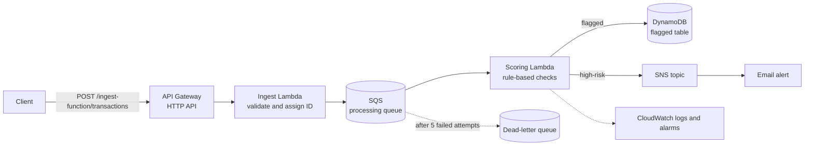

# Serverless Fraud Detection Pipeline on AWS

A serverless, event-driven pipeline that scores card transactions as they arrive. Transactions come in through an HTTP API, are checked and queued, scored by rules, and saved when they look suspicious. High-risk transactions also send an email alert.

> **Status: working prototype.** The pipeline runs end to end on AWS, but only one fraud rule is built so far. See [What is built and what is planned](#what-is-built-and-what-is-planned). Use made-up data only.

## Architecture



| Component | AWS service | Role |
|---|---|---|
| Transactions API | API Gateway (HTTP API) | Public entry point |
| Ingest function | Lambda (Node.js 22, arm64) | Validates the payload, assigns a transaction ID, queues it |
| Processing queue + dead-letter queue | SQS | Decouples ingest from scoring, retries failures, keeps messages that keep failing |
| Scoring function | Lambda (Node.js 22, arm64) | Scores each transaction, saves flagged ones, sends alerts |
| Flagged transactions table | DynamoDB (on-demand) | Stores flagged transactions |
| Alerts topic | SNS | Sends the email alert |
| Logs and alarms | CloudWatch | 14-day logs and error alarms on the functions |

The infrastructure is defined in CloudFormation. Deployed in `eu-west-1`.

## How scoring works

Each transaction gets a risk score from 0 to 1.

| Amount | Rule fired | Risk score | What happens |
|---|---|---|---|
| Below 5000 | none | 0 | Logged only |
| 5000 up to 24999 | `HIGH_AMOUNT` | 0.6 | Flagged and saved to DynamoDB |
| 25000 or more | `VERY_HIGH_AMOUNT` | 0.9 | Flagged, saved, and an email alert is sent |

A transaction is flagged at a score of 0.5 or more, and an alert is sent at 0.8 or more. The thresholds are constants at the top of `functions/scoring-function/index.ts`.

A message that is not a valid transaction fails, is retried, and after 5 failed attempts moves to the dead-letter queue.

## API

`POST /ingest-function/transactions`

```bash
curl -X POST "https://YOUR-API-URL/ingest-function/transactions" \
  -H "content-type: application/json" \
  -d '{"cardId":"card-123","amount":9500,"merchantId":"m-1","location":"Lagos","timestamp":"2026-10-30T10:00:00Z"}'
```

| Field | Rule |
|---|---|
| `cardId`, `merchantId`, `location` | Required, text |
| `amount` | Required, number greater than 0 |
| `timestamp` | Required, a valid date and time |

A valid request returns `202` with a `transactionId` and a `messageId`. An invalid one returns `400` with a list of what is wrong.

`GET /ingest-function/health` is a simple health check.

## What is built and what is planned

**Built**
- HTTP API with input validation and generated transaction IDs
- SQS queue with a dead-letter queue and retries
- Scoring with an amount-based rule and two risk tiers
- Flagged transactions saved to DynamoDB
- Email alerts for high-risk transactions through SNS
- CloudWatch logs and alarms
- Unit tests from the starter kit (10 passing)

**Planned**
- Velocity rule: too many transactions on one card in an hour
- Impossible-travel rule
- Isolation Forest anomaly model, packaged as a Lambda layer
- Explanations written by Amazon Bedrock for flagged transactions
- Data lake in S3 (Parquet) with Glue and Athena for analysis
- `GET /flagged` route to review flagged transactions
- Authentication on the API
- Unit tests for the new validation and scoring logic

## Deploying

The project has deploy scripts (`scripts/deploy.sh`) that build and deploy everything. I deployed through the AWS console instead, using a variant of the template:

1. `npm install`, then `npm run build`. This compiles the TypeScript functions into `build/`.
2. Zip each `build/<name>-function/index.mjs` as `<name>-function.zip`.
3. Create an S3 bucket in the same region and upload the four zips under a `functions/` prefix.
4. In CloudFormation, create a stack from `infrastructure/template-console.yaml`. Give the stack a name without spaces, enter your bucket name for the `CodeBucket` parameter, and acknowledge that it creates IAM roles.
5. Subscribe your email to the stack's alerts topic and confirm the subscription.

`template-console.yaml` differs from the original template in two ways: it adds the `CodeBucket` parameter, and each function's `Code` points to an S3 bucket and key instead of a local path.

## What I learned

- **Template validation:** the first deployment failed because the Lambda `Code` property was a plain path where CloudFormation expects an S3 location.
- **Packaging:** Lambda could not find the code until I uploaded the zips to the right S3 key, including the folder prefix.
- **TypeScript:** Lambda cannot run `.ts` files, so the functions must be compiled to JavaScript first.
- **Tooling:** on Windows, PowerShell blocked `npm` until I changed the script execution policy.
- **Debugging:** CloudWatch logs and the CloudFormation events tab showed the cause each time.

## Cost and cleanup

At test volumes the cost is negligible, since everything is pay-per-use. When you are done:
1. Delete the CloudFormation stack.
2. Delete your code bucket in S3 separately, because it is not part of the stack.

## Security

This is a prototype. The API has no authentication, so do not send real card data, and do not share your API URL publicly.

## Credits

The architecture and sample code started from a kit generated by AWS Architecture Advisor. The starter kit's own instructions are in `README-starter-kit.md`.

What I added:
- Transaction validation and ID generation in the ingest function
- The scoring rule, risk tiers and saving of flagged transactions
- The SNS email alert
- Deployment through the console, and the debugging described above

## Author

Keziah Smith · https://www.linkedin.com/in/keziah-smith-5921b2268?utm_source=share_via&utm_content=profile&utm_medium=member_ios
